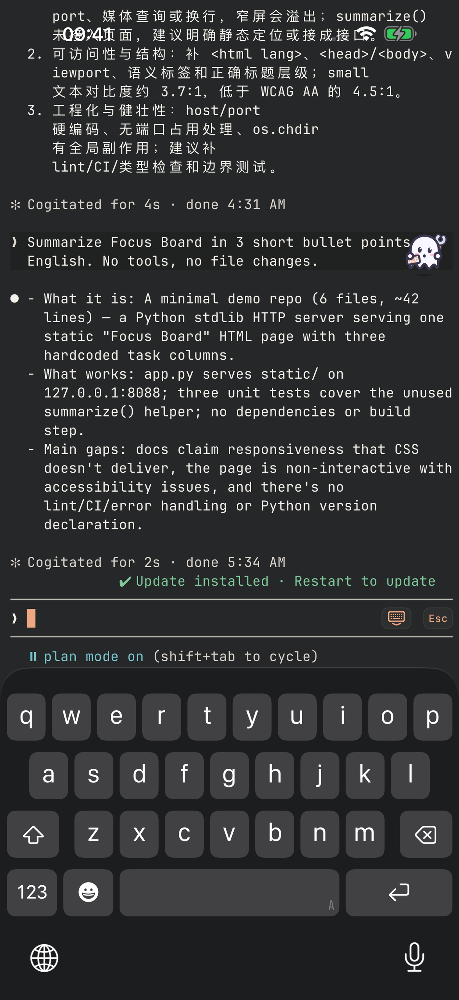
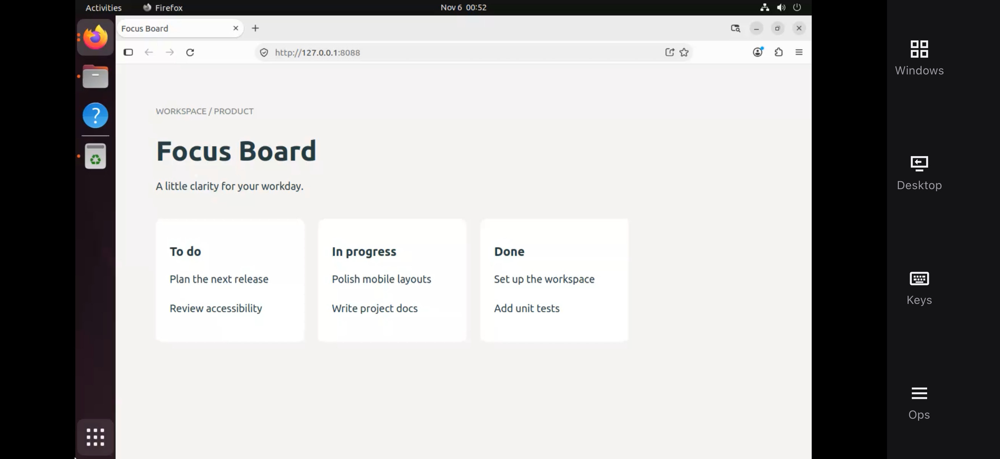

# Roamtty iOS

**Leave your desk. Keep your AI workspace.** Mobile SSH for remote Claude Code / Codex sessions, SFTP, and the same host’s remote desktop.

<p align="left">
  <a href="https://apps.apple.com/app/id6826986771">
    
  </a>
</p>

[App Store](https://apps.apple.com/app/id6826986771) · [Product site & setup](https://roamtty.com/en/) · [中文文档](https://roamtty.com) · [Privacy architecture](PRIVACY-ARCHITECTURE.md)

US App Store: **US$1.99 one-time** (local prices vary; as of November 8, 2026). No app subscription; AI model access is not included. Apache-2.0 source — build with your own signing setup.

Swift iOS client: saved SSH hosts, monitoring, independent shell/tmux sessions, native terminal, mosh, SFTP, file previews and transfers, coding-agent launchers, and sharing from iOS. Behavior reference: Android `yahaa/roamtty` main `5fc87b3` (earlier parity: `bee299d`). Uses SwiftUI, UIKit/SwiftTerm, libssh2, OpenSSL, SQLite, and device-only Keychain. Requires iOS 16 or later.

## Continue your work away from your desk

Your AI tools run on your computer. Roamtty lets your iPhone reconnect to that workspace: continue a terminal session, inspect files over SFTP, then switch to the host's desktop to check a browser preview.

### Terminal to browser preview

These iPhone screenshots show the Focus Board demo project in a terminal and in a remote Ubuntu desktop browser.

<p>
  
</p>

When the next check is visual, open the same host's remote desktop:

<p>
  
</p>

### Before you buy

- You need your own reachable computer with SSH enabled and your own AI tools installed there. Roamtty does not provide a hosted computer or model credits.
- For access over Tailscale, install and configure Tailscale separately on the phone and host, and allow the required traffic. It is not bundled with Roamtty.
- Remote desktop requires a graphical desktop and the host-side desktop component; an SSH connection alone does not provide a desktop.
- If your existing Claude remote workflow already covers what you need, you may not need another app. Roamtty is useful when you also want a regular terminal, SFTP and the host's graphical desktop together.
- This public repository covers **iOS only**. Android source is not included.

## About this source snapshot

This repository contains the iOS source from development revision `9d668ce`, published as a clean snapshot without private development history, account metadata, or build artifacts. It does not include uncommitted development work. Internal machine paths and fixture addresses have been replaced with examples.

Roamtty combines an SSH terminal, AI coding sessions, SFTP and remote desktop access to your own hosts. It can use an existing Tailscale network connection: connect the phone and host to the same tailnet, enable SSH on the host and allow the required traffic. Tailscale must be installed and configured separately; it is not bundled into this app.

See [Privacy architecture](PRIVACY-ARCHITECTURE.md) for credential storage, local previews, agent hooks and external download services. Source availability supports inspection; it is not a guarantee of security or protection from AI-provider account restrictions.

The app is available on the [App Store](https://apps.apple.com/app/id6826986771). Building the source yourself requires your own development/signing setup. See [LICENSE](LICENSE) and [THIRD_PARTY_NOTICES.md](THIRD_PARTY_NOTICES.md) for licensing.

## Build on macOS

```sh
./scripts/bootstrap-native.sh
DEVELOPMENT_TEAM=YOUR_TEAM_ID python3 scripts/generate-project.py
open Roamtty.xcodeproj
```

Select the Roamtty scheme. The app and share extension use a shared Keychain access group for their durable file inbox. A development profile supporting wildcard Keychain groups can build without an App Group:

```sh
xcodebuild -project Roamtty.xcodeproj -scheme Roamtty \
  -destination 'generic/platform=iOS' -derivedDataPath DeviceBuild \
  ROAMTTY_ENTITLEMENTS=App/Support/Development.entitlements build
```

For App Group storage, enable `group.com.roamtty.shared` for both bundle identifiers in the signing profiles, then build with both settings:

```sh
xcodebuild -project Roamtty.xcodeproj -scheme Roamtty \
  -destination 'generic/platform=iOS' -derivedDataPath DeviceBuild \
  ROAMTTY_ENTITLEMENTS=App/Support/Roamtty.entitlements \
  ROAMTTY_APP_GROUP_ENABLED=YES \
  -allowProvisioningUpdates build
```

Dependencies are version-pinned; native downloads are SHA-256 checked. Generated project files are checked in; regenerate when adding sources. Native build artifacts stay outside version control.

## Project layout

```
Sources/
  CNative/            C shims (sockets, crypto, local files) linking libssh2, OpenSSL and SQLite
  RoamttyCore/        platform-independent logic, unit tested on macOS and Linux
    Model/            hosts, settings, session journal
    Persistence/      the SQLite store
    Security/         Keychain vault, in-memory logins, host-key pins, private keys
    Sessions/         reconnect rules, login and connection snapshots, generations
    Remote/           shell commands run on hosts, metrics, plugins, agent status
    Files/            remote listings, sorting, local download folders
    Terminal/         shortcuts, URL finder, mouse tracking, output history
    Text/             syntax highlighting, Markdown, code search
  RoamttyTransport/   SSH/SFTP (SSH/) and mosh (Mosh/)
App/
  Roamtty/            the iOS app
    Application/      entry point and launch splash
    Navigation/       routes, sheets, the root stack and drawer
    Model/            AppModel, the state screens observe, split by feature in extensions
    Services/         diagnostics, reachability, the share inbox, per-session preferences
    DesignSystem/     palette, shared components, button styles, formatting
    Features/         Home, Hosts, Sessions, Terminal, Files, Settings, Authentication
    Debug/            on-device validation (Debug builds only)
    Resources/        fonts and the asset catalog
  Shared/             code shared by the app and the share extension
  ShareExtension/     the share extension
  UITests/            XCTest UI suite against live SSH fixtures
Tests/                RoamttyCore and RoamttyTransport unit and live tests
```

Views read state from `AppModel` and call its actions; logic that needs no UIKit lives in `RoamttyCore`, where it is unit tested. `scripts/generate-project.py` picks up every source file under these folders.

## Lint

```sh
./scripts/lint.sh   # SwiftLint with .swiftlint.yml, --strict: any warning fails
```

Every rule the config turns off, and every inline `swiftlint:disable`, carries its reason next to it.

## Tests

```sh
# macOS Core and transport tests
swift test

# Linux: Swift 6+, CMake, OpenSSL/zlib development headers
./scripts/bootstrap-linux-native.sh
swift test

# Live OpenSSH tests use the Android project's dedicated itermux_test fixture account.
# Fixture credentials remain in ../roamtty/.private/test-password.
./scripts/test-linux.sh
```

`./scripts/test-terminal-url.sh` checks terminal URLs, wide cells, scrollback, reset lifecycle and bounded accessibility export against the same commit-pinned [SwiftTerm fork](https://github.com/yahaa/SwiftTerm) as the app. The upstream v1.13.0 base and two downstream patches are documented in [`docs/dependencies/swiftterm.md`](docs/dependencies/swiftterm.md).

The mosh tests exercise wire-format vectors and an installed `mosh-server`, when available. Live SSH tests cover password/interactive/encrypted-key authentication, PTY, concurrent SFTP, no-overwrite and cancellation. Tests requiring unavailable services explicitly skip. XCTest UI tests are in `App/UITests`; sign simulator builds with `CODE_SIGN_IDENTITY=-` and the development entitlements so credential storage is exercised.

For the complete native simulator suite, put the dedicated server's `host`, `port`, `username`, and `password` in the ignored `.private/device-fixture.json`. Authorize the Android fixture's public keys on that server and keep `tmux`, `mosh-server`, and Python 3 available. Then run on the Mac:

```sh
./scripts/test-simulator.sh
```

The script creates or reuses **Roamtty Validation**, builds and installs the app and extension, seeds Photos, native Files documents and the encrypted test key, and executes the UI suite serially. It defaults to an iPhone 17 on the newest installed iOS runtime. Override `ROAMTTY_TEST_SIMULATOR` with an existing simulator UUID, or `ROAMTTY_SIM_DEVICE_TYPE` / `ROAMTTY_SIM_RUNTIME` when creating one. `ROAMTTY_TEST_ENCRYPTED_KEY` overrides the adjacent Android fixture's key path. The font import test uses the Mac's Andale Mono font. Results and private XCTest logs stay under ignored `TestResults`; the script prints only test outcomes. See [simulator coverage](docs/SIMULATOR-COVERAGE.md) for actual executed results.

The complete suite also needs two disposable Linux fixtures. Start these on an address reachable by the Mac (the recovery fixture requires OpenSSH and permission to run the dedicated test account; the plugin fixture requires Docker, Python 3 and OpenSSH clients):

```sh
sudo -n python3 scripts/serve-recovery-fixture.py --bind YOUR_LAN_IP --lifetime 7200
python3 scripts/serve-plugin-fixture.py --bind YOUR_LAN_IP
```

Copy the private JSON paths printed by these processes to the Mac's ignored `.private/recovery-environment.json` and `.private/plugin-environment.json`. The runner injects their strictly checked fields without printing values. Recovery tests use real changed host keys, closed TCP connections and unreachable mosh UDP. Plugin tests install real packages inside disposable containers and cancel an actual throttled download. Restart the plugin fixture and copy its new JSON before repeating its install test, because a successful run has installed tmux. Stop only the fixture supervisor processes when finished; their lifetimes are bounded. Individual classes can be selected with `./scripts/test-simulator.sh -only-testing:RoamttyUITests/NativeFileWorkflowUITests`.

The two privileged exec cancellation tests explicitly skip in the ordinary SSH suite. Run them against the disposable cancellation container, while no UI test is using it:

```sh
ROAMTTY_TEST_HOST=YOUR_LAN_IP ROAMTTY_TEST_PORT=23016 \
  ROAMTTY_TEST_AUTH=interactive ROAMTTY_TEST_SUDO_FIXTURE=1 \
  ROAMTTY_TEST_PASSWORD_FILE=../roamtty/.private/test-password \
  swift test --filter SSHExecTests.testSudo
```

These checks stop a real sudo command and a real apt download, verify the package remains absent, and keep another exec on the same SSH connection running.

The desktop gesture tests need a live desktop host with `roamtty-desktop`, so the full suite skips them. Run them on the Mac against a disposable Ubuntu, Windows or macOS host. The host file has the same fields as `device-fixture.json`:

```sh
./scripts/test-desktop-gestures.sh .private/ubuntu.json                           # the whole class
./scripts/test-desktop-gestures.sh .private/ubuntu.json testTrackpadModeGestures  # one test
```

Some of these tests act on the host itself: they show its desktop, toggle full screen with ⌃⌘F, or type its password at the lock screen. Read a test's comment before running it against a machine someone is using.

The custom font checks use real CoreText on macOS:

```sh
swiftc App/Roamtty/Features/Settings/Fonts/CustomFontStore.swift scripts/test-font-catalog.swift -o /tmp/roamtty-font-checks
/tmp/roamtty-font-checks
```

The Foundation-only share recovery checks also run on Linux:

```sh
swiftc App/Shared/ShareInboxStore.swift scripts/test-share-inbox.swift -o /tmp/roamtty-share-tests
/tmp/roamtty-share-tests
```

The macOS share worker checks exercise background ordering, security-scope lifetime, cancellation, and recovery with real temporary files:

```sh
swiftc App/Shared/ShareInboxStore.swift App/Shared/ShareInboxWorker.swift App/Roamtty/Services/SharedInbox.swift scripts/test-share-worker.swift -o /tmp/roamtty-share-worker-tests
/tmp/roamtty-share-worker-tests
```

`docs/PLAN.md` records the intended parity scope; `docs/PROGRESS.md` records verification and remaining work. Device and visual checks require Xcode and a paired device. See `THIRD_PARTY_NOTICES.md` for licenses.

## Data and lifecycle

Host metadata, settings, host-key pins and tmux session records live in SQLite. Passwords and imported keys use non-synchronizing Keychain entries bound to this device. Key passphrases and terminal output do not persist. Unknown host keys require explicit approval; a changed key stops authentication until the user deliberately clears its old pin.

The share extension publishes at most 20 files, totaling 64 MiB, per transaction. App Group storage is used when explicitly enabled; otherwise the extension and app exchange chunks through a separate, device-only shared Keychain group. Host credentials stay in the app's private Keychain group. Files stay queued across app restarts until uploaded or explicitly removed.

iOS can suspend background execution. tmux preserves the remote session for reattachment; mosh handles UDP roaming and resumes probing on return. The app does not promise an indefinitely running background process.
